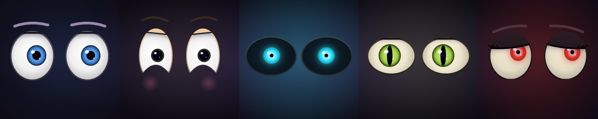
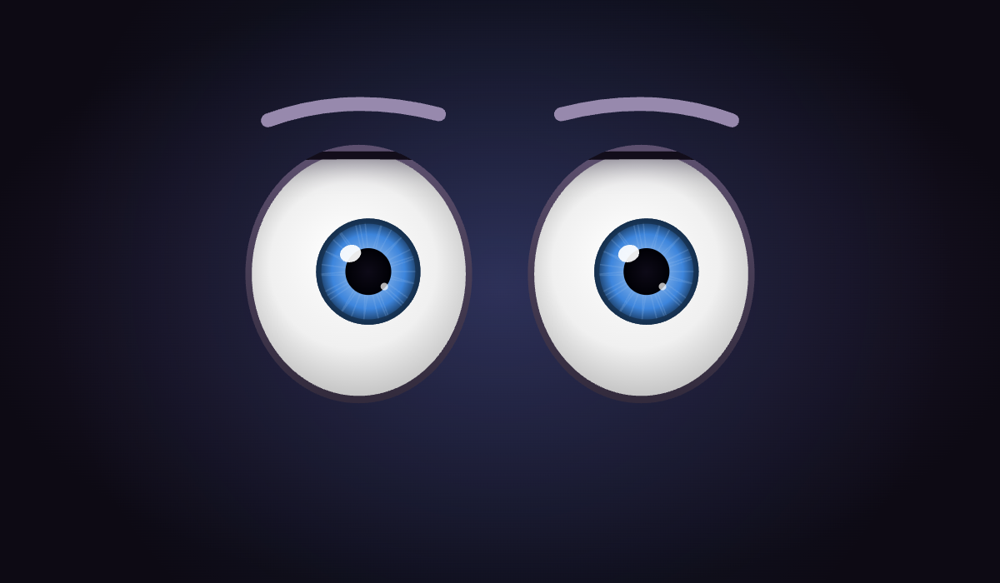
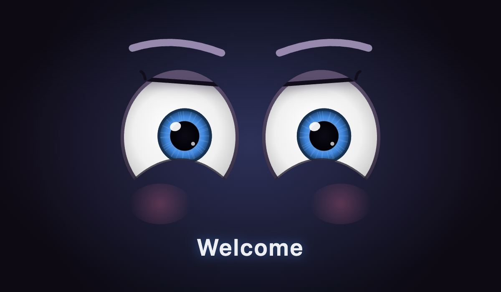
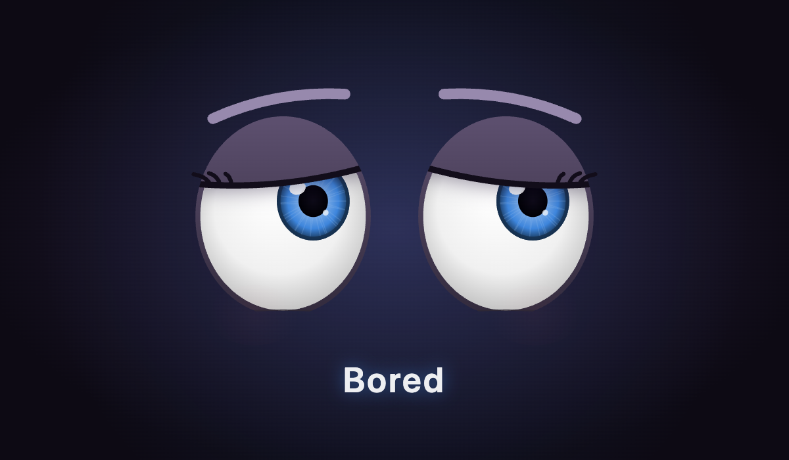
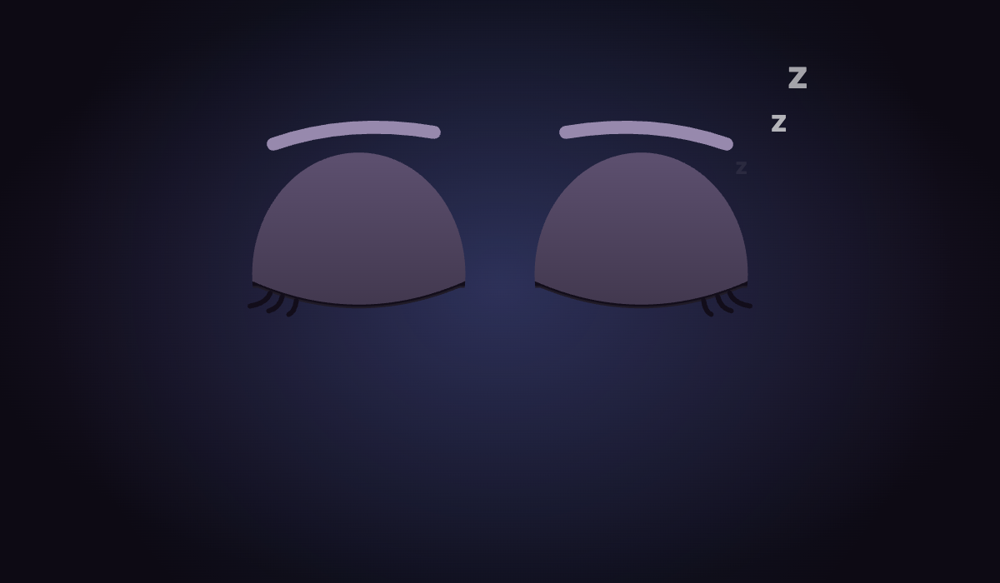
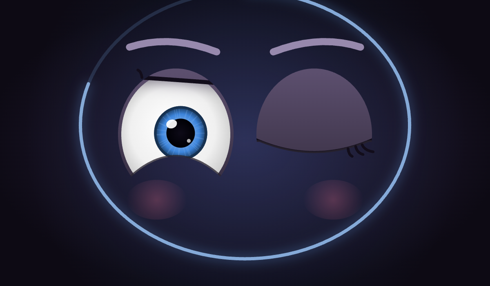
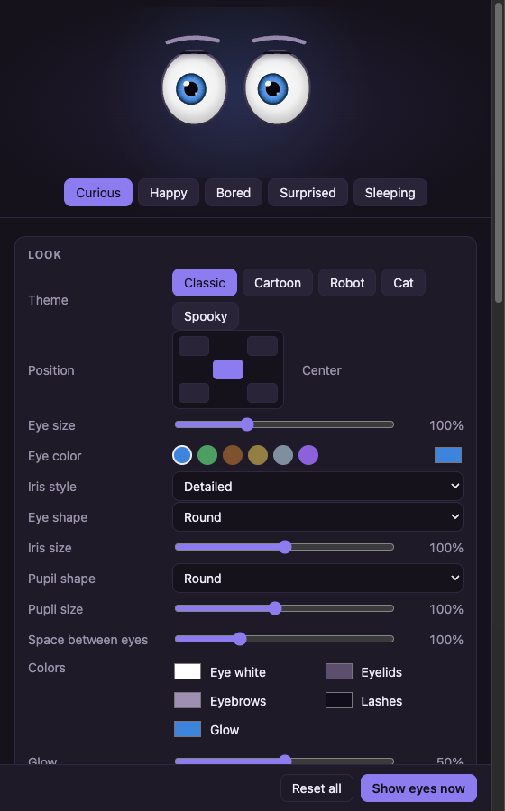

<div align="center">

# 👀 Big Eyes

**Friendly eyes that wake up when you step away from your computer — and look right back at you.**



[](https://github.com/eranra/big-eyes/actions/workflows/ci.yml)
[](LICENSE)


[Install](#-install) · [What it does](#-what-it-does) · [Make it yours](#-make-it-yours) · [Privacy](#-privacy) · [Contribute](#-contribute)

</div>

---

Leave your computer alone for 30 seconds, and a pair of big, curious eyes fades in over your screen.
They **find you with the camera and follow your head**. Look into them and they **smile** 😊.
Look away and they get **bored** 😒. Walk away and they **fall asleep** 😴. Move your mouse to them, or press any key, and they're gone.

It's a tiny bit of life on your desk. Fun for you, your kids, your coworkers, and anyone who walks by.

## 🚀 Install

### macOS — one line

Open **Terminal** and paste:

```sh
curl -fsSL https://raw.githubusercontent.com/eranra/big-eyes/main/install.sh | bash
```

That's it. The script downloads the latest version, puts **Big Eyes** in your Applications folder, and starts it.
Look for the 👀 icon in the menu bar. The first time, macOS asks for camera access. Choose **Allow**.

<details>
<summary>Prefer to drag and drop?</summary>

1. Download `Big-Eyes-<version>-arm64.dmg` (Apple silicon) or `Big-Eyes-<version>-x64.dmg` (Intel) from the [Releases page](https://github.com/eranra/big-eyes/releases/latest).
2. Open it and drag **Big Eyes** onto **Applications**.
3. The first time, **right-click** Big Eyes in Applications and choose **Open**. (This is needed once, because the app is not from the App Store.)

</details>

### Windows

Download `Big-Eyes-Setup-<version>.exe` from the [Releases page](https://github.com/eranra/big-eyes/releases/latest) and run it.
It installs in one click and starts. If SmartScreen appears, choose **More info → Run anyway**. Big Eyes lives in the system tray.

### Linux

Download the `AppImage` from the [Releases page](https://github.com/eranra/big-eyes/releases/latest), then:

```sh
chmod +x Big-Eyes-*.AppImage && ./Big-Eyes-*.AppImage
```

On Debian or Ubuntu you can also install the `.deb`: `sudo apt install ./big-eyes_*.deb`.

### Uninstall

- **macOS:** `curl -fsSL https://raw.githubusercontent.com/eranra/big-eyes/main/install.sh | bash -s -- --uninstall`, or drag the app to the Trash.
- **Windows:** Settings → Apps → Big Eyes → Uninstall.
- **Linux:** delete the AppImage, or `sudo apt remove big-eyes`.

## ✨ What it does

| | |
|---|---|
|  | **Curious.** The eyes appear after 30 seconds without keyboard or mouse use. They find you and follow your head, and the whole pair drifts a little toward you. |
|  | **Happy.** Look straight into them and they smile, with rosy cheeks. Smile back and they smile even more. |
|  | **Bored.** Look away for a few seconds and their lids get heavy, they roll their eyes, and they look somewhere else too. |
|  | **Sleeping.** Nobody there? They doze off. When someone shows up, they wake up surprised. |

**They always feel alive:** natural blinks (sometimes a double blink), quick little eye jumps, slow breathing,
springy movement, expressive eyebrows, and wet-looking highlights.

**They never get in the way:**

- Press **any key** or **click**, and they fade away. Clicks go straight through to the app underneath.
- By default, moving the mouse **onto the eyes** closes them; moving it elsewhere is fine.
  You can change this to *any mouse movement* or *never* (then only a key or click closes them).
- Optional: **look into the eyes to close them.** Hold eye contact for a moment, a ring fills up, and they wink goodbye. 😉
- They don't take keyboard focus and don't appear while your screen is locked.
- On macOS they also wait while a video or presentation is playing.



## 🎨 Make it yours

Click the 👀 icon for quick choices, or open **Settings…** for everything, with a live preview:



| Setting | Choices | Default |
|---|---|---|
| **Look** | Classic, Cartoon, Robot, Cat, Spooky — or mix your own | Classic |
| **Colors** | Iris, eye white, eyelids, eyebrows, lashes, glow | Blue eyes |
| **Shape** | Round, tall or wide eyes; detailed, simple or glowing iris; round or cat pupils; size; spacing | Round |
| **Details** | Eyebrows, lashes, rosy cheeks — each on or off | All on |
| **Eye size** | Very Small, Small, Medium, Large, Huge, or any size | Medium |
| **Position** | Center, top left, top right, bottom left, bottom right | Center |
| **Blinking** | How often (never … very often) and how fast (slow and sleepy … quick) | Normal |
| **Closing** | Mouse onto the eyes, any mouse movement, or never; and *look into the eyes to close them* (1–10 s) | Mouse onto the eyes; look-to-close off |
| **Show after** | 15 seconds … 10 minutes, or any time | 30 seconds |
| **Screens** | Built-in screen, main screen, all screens, or the ones you pick | Built-in screen |
| **Camera** | Built-in camera, system default, or any connected camera | Built-in camera |
| **Text** | Show a word under the eyes when you look at them ("Welcome") and when you look away ("Bored") — and write your own words | Off |
| **Background** | See-through … dark | Light |
| **Calibrate** | Teach the eyes how *you* look at them, for your camera position | Built-in values |
| **Other** | Mirror camera, open at login, pause | |

Settings are saved automatically and survive restarts and updates. They live in a small JSON file you can also edit:

| System | Settings file |
|---|---|
| macOS | `~/Library/Application Support/Big Eyes/settings.json` |
| Windows | `%APPDATA%\Big Eyes\settings.json` |
| Linux | `~/.config/Big Eyes/settings.json` |

> **Tip:** if the eyes don't smile when you look at them, choose **Calibrate Eye Contact…** in the menu and look into the eyes for 3 seconds.

## 🔒 Privacy

- 🖥️ **Everything stays on your computer.** The camera picture is analyzed locally by Google's open-source [MediaPipe](https://ai.google.dev/edge/mediapipe/solutions/vision/face_landmarker). Nothing is uploaded, and the app makes no network requests.
- 🚫 **Nothing is recorded.** No pictures or videos are saved.
- 💡 **The camera only runs while the eyes are on screen.** Your camera light shows it.
- 🎙️ **No microphone.** Ever.

Details: [docs/privacy.md](docs/privacy.md).

## ❓ Troubleshooting

| Problem | Fix |
|---|---|
| The eyes don't smile when I look at them | Menu → **Calibrate Eye Contact…** |
| The eyes look the wrong way | Menu → **Mirror Camera** |
| The eyes close too easily | Menu → **Closing** → **Mouse movement never closes them** |
| The eyes never appear | Check that **Pause** is off. On macOS, a video tab or call can hold them back (**Don't Show During Video**). |
| "I can't see you" | Allow camera access: macOS **System Settings → Privacy & Security → Camera**; Windows **Settings → Privacy → Camera**. |
| Wrong camera or screen | Menu → **Camera** / **Screens** |

More help: [docs/troubleshooting.md](docs/troubleshooting.md).

## 🛠️ Build from source

You need [Node.js](https://nodejs.org/) 20 or newer.

```sh
git clone https://github.com/eranra/big-eyes.git
cd big-eyes
npm install
npm run fetch-model       # the face model, 3.7 MB
npm start                 # run it

./install.sh --from-source   # macOS: build and install into /Applications
npm run dist                 # build an installer for your system into ./dist
```

Big Eyes is built with [Electron](https://www.electronjs.org/), TypeScript and MediaPipe.
How it works inside: [docs/architecture.md](docs/architecture.md).

## 🤝 Contribute

Ideas, bug reports, new themes and code are all very welcome — see **[CONTRIBUTIONS.md](CONTRIBUTIONS.md)**.
New here? A new eye theme is a great first contribution: it's just a few lines of colors and shapes.

Please follow our [Code of Conduct](CODE_OF_CONDUCT.md). Security issues: see [SECURITY.md](SECURITY.md).

If Big Eyes made you smile, please ⭐ the repository so others can find it.

## 📄 License

Big Eyes is open source under the [Apache License 2.0](LICENSE). See [NOTICE](NOTICE) and
[THIRD_PARTY_NOTICES.md](THIRD_PARTY_NOTICES.md) for the components it uses.
